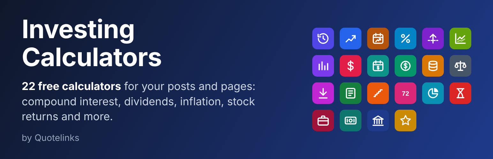
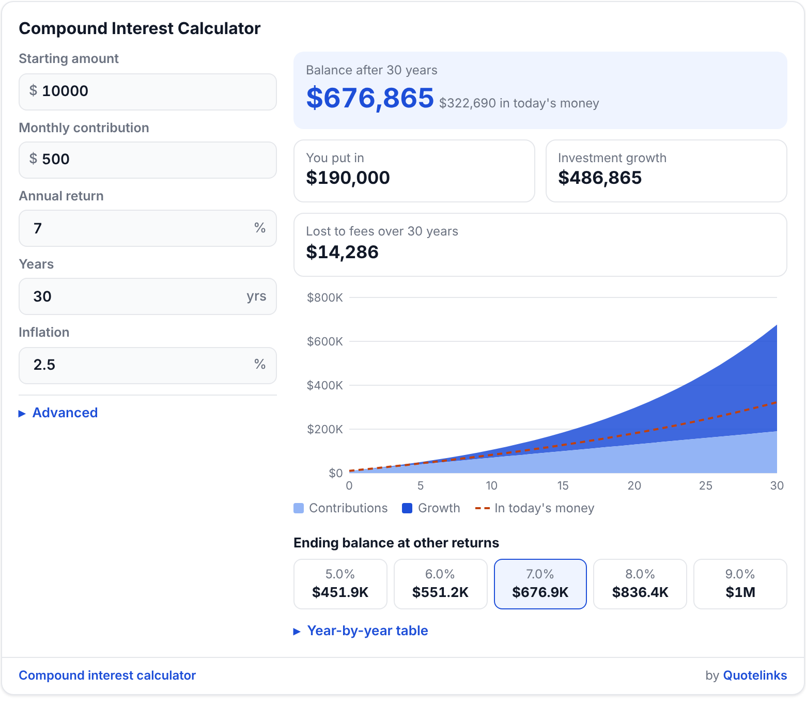
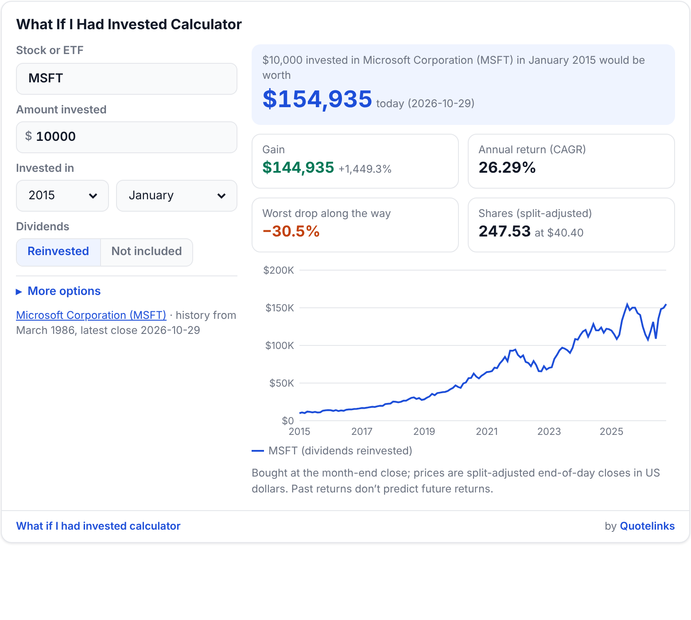
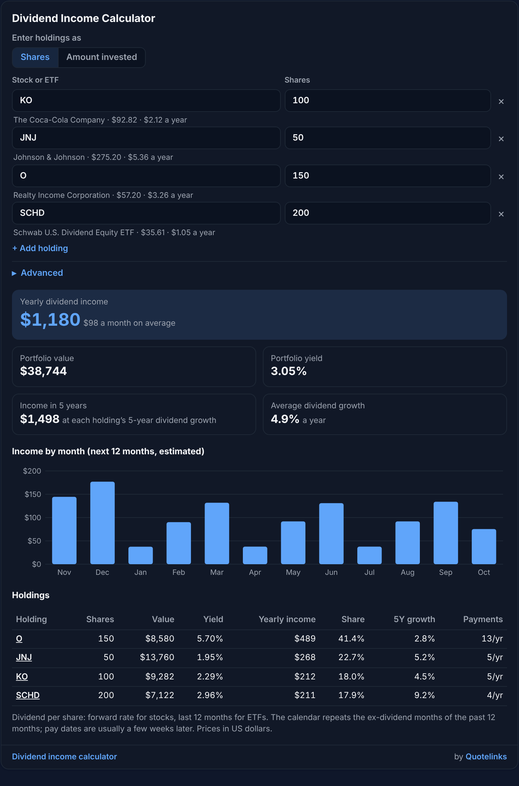
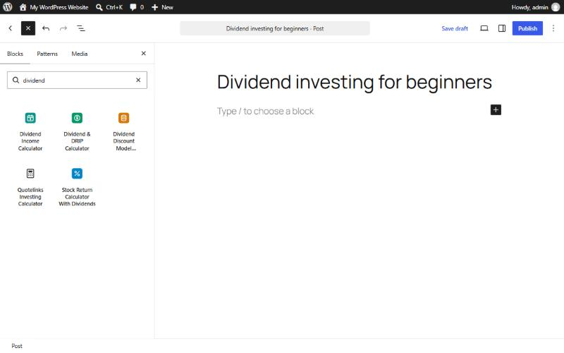
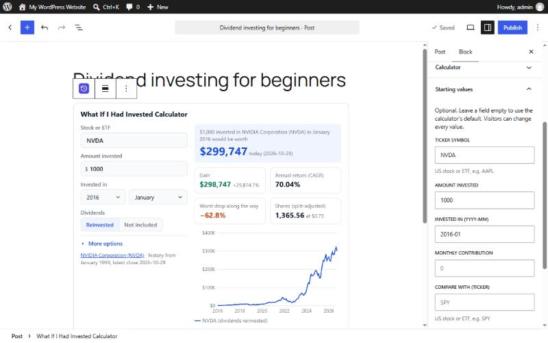

# Free Investing Calculators for Websites

[](https://www.quotelinks.com/calculators/)

**22 free investing calculators you can add to any website, blog or WordPress site**: compound interest, dividend income, DRIP, historical inflation, stock return, portfolio backtest, bond yield, Graham number and more. They have interactive charts, work on phones and come in light and dark themes, with 11 currencies. No sign-up, no API key, no cost.

- **Live calculators and embed-code generator:** [www.quotelinks.com/calculators/](https://www.quotelinks.com/calculators/)
- **WordPress plugin:** [Quotelinks Investing Calculators](https://wordpress.org/plugins/quotelinks-investing-calculators/) (in review at WordPress.org; source in [`wordpress-plugin/`](wordpress-plugin/))
- **Live examples:** [quotelinks.github.io/quotelinks-investing-calculators/examples/](https://quotelinks.github.io/quotelinks-investing-calculators/examples/)

| Compound interest | What if I had invested | Dividend income (dark theme) |
|---|---|---|
| [](https://www.quotelinks.com/calculators/compound-interest.html) | [](https://www.quotelinks.com/calculators/what-if-invested.html) | [](https://www.quotelinks.com/calculators/dividend-income.html) |

## Quick start

Paste this into your page's HTML (WordPress "Custom HTML" block, Blogger "HTML/JavaScript" gadget, Wix "Embed code", Squarespace "Code" block, Webflow "Embed", Ghost "HTML" card or any static site):

```html
<!-- Compound interest calculator by Quotelinks - free to embed. Please keep the credit line under the calculator visible and unchanged. -->
<iframe src="https://www.quotelinks.com/calculators/embed/compound-interest.html" title="Compound interest calculator" loading="lazy" referrerpolicy="strict-origin-when-cross-origin"
  style="display:block;width:100%;max-width:760px;height:700px;border:0"></iframe>
<p style="max-width:760px;margin:6px 0 0;font-size:13px"><a href="https://www.quotelinks.com/calculators/compound-interest.html">Compound interest calculator</a> by <a href="https://www.quotelinks.com/">Quotelinks</a></p>
<script src="https://www.quotelinks.com/calculators/resize.js" async></script>
```

To embed a different calculator, replace `compound-interest` with its name from the table below, and use the height from the table. The easiest way is the generator at the bottom of each calculator page: pick the layout, theme and currency, type your starting values into the calculator and copy the code.

## The calculators

| Calculator | What it does | Starting-value parameters | Height (px) article / sidebar |
|---|---|---|---|
| [What If I Had Invested Calculator](https://www.quotelinks.com/calculators/what-if-invested.html) | What an investment in any US stock or ETF in any past month would be worth today, vs the S&P 500. | `symbol`, `amount`, `from`, `monthly`, `compare` | 690 / 1110 |
| [Compound Interest Calculator](https://www.quotelinks.com/calculators/compound-interest.html) | How a starting amount and monthly savings grow over time, after fees, tax drag and inflation. | `start`, `monthly`, `rate`, `years`, `inflation` | 700 / 1120 |
| [Historical Inflation Calculator](https://www.quotelinks.com/calculators/historical-inflation.html) | What an amount from any year or month since 1913 is worth in another, from official US CPI data. | `amount`, `from`, `to` | 760 / 1010 |
| [Stock Return Calculator With Dividends](https://www.quotelinks.com/calculators/stock-return.html) | Total return, price return and the part added by dividends for any stock or ETF between two months. | `symbol`, `from`, `to`, `amount` | 720 / 1100 |
| [Real Return Calculator (Inflation-Adjusted)](https://www.quotelinks.com/calculators/real-return.html) | The return of any US stock or ETF after inflation between two months, in total and per year. | `symbol`, `from`, `to`, `amount` | 800 / 1270 |
| [Portfolio Backtest Calculator](https://www.quotelinks.com/calculators/portfolio-backtest.html) | How a mix of up to 10 stocks and ETFs would have done: return, volatility and worst drawdown. | `portfolio`, `amount`, `monthly`, `from`, `rebalance` (yearly \| quarterly \| never), `compare` | 1300 / 1400 |
| [Investment Return Calculator (CAGR & IRR)](https://www.quotelinks.com/calculators/investment-return.html) | Your annual return from start and end values, or from dated deposits and withdrawals (XIRR). | `start`, `end`, `years`, `symbol`, `from`, `inflation`, `benchmark` | 990 / 1080 |
| [Stock Profit Calculator](https://www.quotelinks.com/calculators/stock-profit.html) | Profit or loss, return, break-even price and tax on a stock trade, including commissions. | `symbol`, `shares`, `buy`, `sell`, `buyfee`, `sellfee` | 700 / 1130 |
| [Dividend Income Calculator](https://www.quotelinks.com/calculators/dividend-income.html) | Yearly and monthly dividend income from your stocks and ETFs, with a month-by-month calendar. | `portfolio`, `mode` (shares \| amount), `tax` | 1180 / 1290 |
| [Dividend & DRIP Calculator](https://www.quotelinks.com/calculators/dividend-drip.html) | Future dividend income, yield on cost and how much reinvesting dividends adds. | `symbol`, `amount`, `price`, `yield`, `divgrowth`, `pricegrowth`, `years`, `monthly` | 820 / 1420 |
| [Dividend Discount Model Calculator](https://www.quotelinks.com/calculators/dividend-discount.html) | Fair value of a dividend stock with the Gordon growth or two-stage model, and the growth priced in. | `symbol`, `dividend`, `price`, `rate`, `growth`, `model` (one \| two), `years`, `terminal` | 620 / 1120 |
| [Graham Number Calculator](https://www.quotelinks.com/calculators/graham-number.html) | Benjamin Graham’s fair value from earnings and book value, with the margin of safety and his tests. | `symbol`, `eps`, `bvps`, `price`, `growth`, `aaa` | 740 / 1160 |
| [Average Down Calculator](https://www.quotelinks.com/calculators/average-down.html) | Your new average cost after buying more shares, or the shares needed to reach a target average. | `symbol`, `shares`, `cost`, `price`, `buy`, `target` | 650 / 1100 |
| [Bond Yield to Maturity Calculator](https://www.quotelinks.com/calculators/bond-yield.html) | Yield to maturity, current yield, yield to call and duration from a bond’s price, coupon and maturity. | `face`, `price`, `coupon`, `years`, `freq`, `callprice`, `callyears` | 960 / 1340 |
| [DCA vs Lump Sum Calculator](https://www.quotelinks.com/calculators/dca-vs-lump-sum.html) | Investing all at once versus spreading it out, in steady, crash and volatile markets. | `amount`, `months`, `rate`, `cash`, `horizon` | 870 / 1250 |
| [Rule of 72 Calculator](https://www.quotelinks.com/calculators/rule-of-72.html) | How long money takes to double, triple or quadruple, with the exact figure alongside. | `rate`, `amount`, `years` | 1060 / 1330 |
| [Asset Allocation & Rebalancing Calculator](https://www.quotelinks.com/calculators/rebalancing.html) | How far your portfolio has drifted from its target mix and the trades that bring it back. | `new` | 990 / 1060 |
| [Inflation Calculator](https://www.quotelinks.com/calculators/inflation.html) | What things will cost in the future and how much of its value your money loses. | `amount`, `years`, `inflation`, `savings`, `raise` | 880 / 1150 |
| [Salary Inflation Calculator](https://www.quotelinks.com/calculators/salary-inflation.html) | Whether your pay kept up with prices: an old salary in today’s money and your real raise. | `salary`, `from`, `current`, `to` | 710 / 910 |
| [Cash vs Inflation Calculator](https://www.quotelinks.com/calculators/cash-vs-inflation.html) | How cash in a money market fund or earning nothing did against inflation, month by month since 1954. | `amount`, `from`, `to`, `cash` (mm \| zero), `fee`, `tax`, `compare` | 800 / 1190 |
| [Fed Funds Rate History](https://www.quotelinks.com/calculators/fed-rate-history.html) | The federal funds rate since 1954, today’s target range and every Fed hike and cut since 1982. | `period` (all \| 50 \| 30 \| 20 \| 10 \| 5) | 1140 / 1200 |
| [Millionaire Calculator](https://www.quotelinks.com/calculators/millionaire.html) | The month your savings reach $1 million, and what $1 million will be worth by then. | `savings`, `monthly`, `rate`, `target`, `age`, `inflation` | 820 / 1180 |

## Options

Add options to the frame address as URL parameters, for example
`https://www.quotelinks.com/calculators/embed/what-if-invested.html?symbol=MSFT&amount=5000&from=2015-01&theme=dark`

| Parameter | Values | Default |
|---|---|---|
| `theme` | `light`, `dark`, `auto` (follows the visitor's device) | `light` |
| `currency` | `USD`, `EUR`, `GBP`, `CAD`, `AUD`, `NZD`, `CHF`, `INR`, `JPY`, `SGD`, `ZAR` (symbol and number format only; stock prices stay in US dollars) | `USD` |
| `locale` | any BCP 47 tag, e.g. `en-GB`, `de-DE` (number and month format) | from the currency |
| Starting values | the parameters listed for each calculator above; visitors can change every value | the calculator's defaults |

**Layout.** Use `max-width:760px` with the article height for content columns, or `max-width:400px` with the sidebar height for sidebars and narrow columns.

**Auto-height.** The optional `resize.js` line resizes each calculator frame to fit its content, so there is no inner scrollbar. It only listens for size messages from quotelinks.com frames. Without it, the frame keeps the fixed height from the embed code. Some platforms strip scripts; the calculator still works without it.

## WordPress

Install the **Quotelinks Investing Calculators** plugin to add the calculators as a block: click **+** in the editor and search for the calculator by name, e.g. "compound interest" or "dividend".

| Find a calculator in the inserter | Block settings and starting values |
|---|---|
|  |  |

- From WordPress.org: **Plugins → Add New** and search for "Quotelinks Investing Calculators" (available once the review is complete).
- From this repository: download the latest release zip from [Releases](https://github.com/quotelinks/quotelinks-investing-calculators/releases), then **Plugins → Add New → Upload Plugin**.
- Without a plugin: paste the embed code above into a **Custom HTML** block.

## How it works

- Each calculator runs in its own frame from quotelinks.com, so it doesn't conflict with your theme's CSS or scripts and loads lazily.
- Charts are inline SVG; no third-party libraries, cookies, local storage, ads or analytics trackers.
- Stock and ETF calculators use end-of-day US market data (prices, total returns and dividends). Inflation calculators use the US Consumer Price Index (CPI-U) from the Bureau of Labor Statistics, and the Fed funds calculator uses Federal Reserve data, both via FRED.
- The numbers your visitors type are calculated in their browser. Ticker symbols are sent to quotelinks.com to look up prices. See the [privacy policy](https://www.quotelinks.com/privacy.html).

## Terms

Free for personal and commercial websites. Please keep the "by Quotelinks" credit line under the calculator visible and unchanged, and don't modify the calculators or present them as your own. Results are estimates for illustration only, not financial advice. See the [disclaimer and terms](https://www.quotelinks.com/disclaimer.html).

## License

The code in this repository (the WordPress plugin and the examples) is licensed under the [GNU General Public License v2.0 or later](LICENSE). The calculators themselves are a free hosted service of [Quotelinks](https://www.quotelinks.com/); the market data they show is licensed to Quotelinks and is not covered by this license.

## More from Quotelinks

- [Free stock widgets](https://github.com/quotelinks/quotelinks-stock-widgets): stock card, ticker tape and market movers ([live](https://www.quotelinks.com/widgets/))
- [Stock screener](https://www.quotelinks.com/screener.html) and [ETF screener](https://www.quotelinks.com/etf-screener.html)
- [Investing dictionary](https://www.quotelinks.com/dictionary.html)
